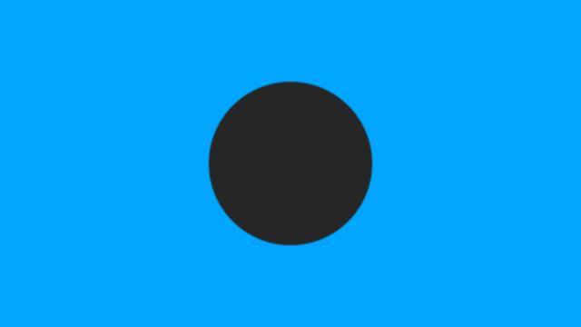

# 네이티브 효과 예제

After Effects 26.3에서 **Edge Light Wrap 네이티브 효과**로 만든 640×360, 24fps 합성 예제입니다.
원형 인물 대용 레이어에는 이미 알파가 있고, 배경은 같은 크기의 파란색 솔리드입니다.
외부 사진·영상이 필요하지 않습니다. 플러그인을 설치한 뒤 `Native Demo.aep`를 엽니다.
Mac에서 만든 프로젝트이며 Windows AE에서도 열 수 있습니다.

| 이미지 | 설정 |
| --- | --- |
| before.png | Strength 0% |
| after.png | Strength 100%, Composite |
| matte.png | Edge Matte |

테스트 설정은 Edge Width 15px, Edge Feather 3px, Wrap Spread 8px, Wrap Softness 9px,
Background Blur 25px입니다. 100% 강도는 작동 확인용 값이며 기본값은 40%입니다.
가장자리 샘플 픽셀은 RGB 38/38/38에서 38/179/255로 바뀌고 중심은 38/38/38을 유지했습니다.

실제 인물 영상에서는 **매트 → 스필 보정 → Edge Light Wrap** 순서를 지키고, 배경의 위치·스케일을
컴포지션 크기의 프리컴프 안에 포함하세요.
